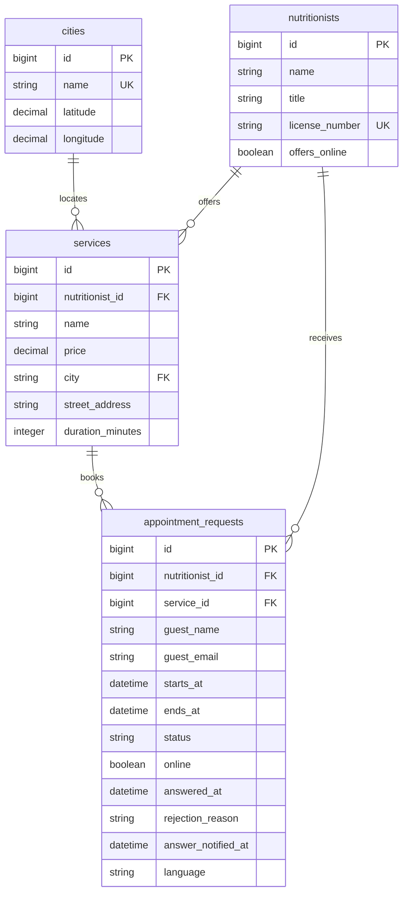

# NutriBook

NutriBook connects guests with nutritionists. Guests search by name, service,
and location, then request an appointment with their name and email. Nutritionists
accept or reject requests, and guests receive the answer by email. Accepting a
request automatically rejects every pending request that overlaps it.

## Getting started

### What to install

- Docker
- Node.js 24, at the exact version in `.nvmrc`. CI reads the same file.
- pnpm

With nvm, run `nvm install` in the repository root to install and select this
Node version.

Ruby, PostgreSQL, Meilisearch, and Mailpit run in Docker. You do not need to
install them on your machine. The frontend runs locally with pnpm.

### Run the project

Clone the repository and install the frontend dependencies:

```sh
git clone https://github.com/rgllm/NutriBook.git
cd NutriBook
pnpm --dir frontend install --frozen-lockfile
pnpm dev
```

On a fresh database, the backend creates the schema, loads the demo seeds, and
builds the search index before it serves requests, so there is no separate seed
step. Open [the application](http://localhost:3000).

| Service | Address | Purpose |
| --- | --- | --- |
| Next.js | <http://localhost:3000> | Frontend |
| Rails | <http://localhost:3001> | Backend |
| API documentation | <http://localhost:3001/docs> | Swagger |
| Mailpit | <http://localhost:8025> | Inbox for development emails |

PostgreSQL and Meilisearch are available only inside the Compose network.
Docker volumes preserve their data across restarts. The credentials in
`compose.yaml` are for local development.

The frontend runs on port 3000 and calls the Rails API at
`http://localhost:3001` by default, so no `.env` file is needed.

### Main commands

Run these from the repository root unless the command specifies a directory.
Backend commands require the development Compose stack to be running.

| Command | What it does |
| --- | --- |
| `pnpm dev` | Build and start Docker services, then run the frontend in development |
| `pnpm stop` | Stop and remove development containers while keeping their data volumes |
| `pnpm backend:logs` | Follow Rails logs |
| `pnpm backend:console` | Open the Rails console |
| `pnpm rails <args>` | Run a Rails command inside the backend container |
| `pnpm db:migrate` | Apply pending migrations |
| `pnpm db:rollback` | Roll back the latest migration |
| `pnpm db:seed` | Add missing demo records, rebuild the search index, and print the demo request URLs |
| `pnpm db:psql` | Open PostgreSQL against the development database |
| `pnpm rails search:reindex` | Rebuild Meilisearch after manual data changes |
| `pnpm check` | Run the backend and frontend checks and the end-to-end lint and typecheck, without Playwright |
| `pnpm test` | Run the Rails and frontend test suites |
| `pnpm backend:test` | Run the Rails test suite |
| `pnpm backend:ci` | Run backend setup, lint, security audits, tests, and a test-database seed replant |
| `pnpm frontend:test` | Run frontend unit and component tests |
| `pnpm lint` | Run backend, frontend, and end-to-end lint |
| `pnpm frontend:typecheck` | Generate Next.js types and run TypeScript checks |
| `pnpm frontend:build` | Build the frontend for production |
| `pnpm e2e` | Reset the isolated test stack and run Playwright |
| `pnpm e2e:ui` | Run the same end-to-end suite in Playwright UI mode |
| `pnpm e2e:lint` / `pnpm e2e:typecheck` | Check the end-to-end test code |
| `pnpm e2e:down` | Remove the end-to-end containers and their data volumes |

## Architecture

### Backend architecture

The Rails API owns search, validation, scheduling, and request state changes.
Controllers handle HTTP input and responses. Domain behavior lives in models
and small plain Ruby objects:

| Component | Responsibility |
| --- | --- |
| `AppointmentRequest` | Submit, supersede, accept, and reject requests inside transactions |
| `BookingSchedule` | Interpret Lisbon dates and enforce bookable start times |
| `NutritionistSearch` | Resolve locations, search, preload services, and paginate results |
| `NutritionistIndex` | Build Meilisearch documents and rank typed queries |
| `City` | Find the nearest city with available services |
| `AppointmentAnswerEmailJob` | Send answer emails with retries and a delivery marker |
| `AppointmentRequestMailer` | Render accepted and rejected emails, including overlap rejections |

Meilisearch indexes one document per nutritionist and city, including the service
names offered there. Rails resolves the city first, retrieves ranked IDs, then
loads the records from PostgreSQL. Searches without a query use SQL directly.
If Meilisearch is unavailable, times out, or has no index, Rails falls back to
case- and accent-insensitive SQL matching. The fallback has no typo tolerance.
The index rebuilds at startup and after seeding because the app has no interface
for editing nutritionists or services.

Active Job uses Solid Queue in the same PostgreSQL database as the domain data.
The worker runs inside Puma in development. Answering a request stores its state
change and email jobs in one transaction. SMTP delivery happens afterwards,
through Mailpit in development.

The API contract lives in [openapi.yaml](backend/public/openapi.yaml).
The main endpoints are:

| Method | Path | Purpose |
| --- | --- | --- |
| GET | `/nutritionists?q=&location=&page=` | Search nutritionists, five per page |
| GET | `/locations` | List cities with services and the default city |
| GET | `/locations/nearest?latitude=&longitude=` | Resolve coordinates to the nearest supported city |
| POST | `/appointment_requests` | Submit a guest's appointment request |
| GET | `/nutritionists/:id/appointment_requests` | List a nutritionist's pending requests |
| PATCH | `/nutritionists/:nutritionist_id/appointment_requests/:id` | Accept or reject a request |

### Frontend architecture

Next.js App Router pages fetch Rails data in Server Components. The server-only
API client in `frontend/src/lib/api/` validates responses with Zod, converts
snake_case keys to camelCase, and parses decimal prices. Requests use
`cache: "no-store"` and a five-second timeout, so appointment lists stay fresh.

Search state lives in `q`, `location`, and `page` URL parameters. The search
form submits with `next/form`, which makes results shareable and supports GET
submission without JavaScript. Suspense boundaries stream results and request
lists with skeletons while their data loads.

Booking and answer forms call Server Actions. Client components handle the
dialog, calendar, pending states, field errors, and toasts. `useActionState`
tracks form results and `useFormStatus` supplies pending feedback. Answering a
request refreshes the page data so answered and automatically rejected cards
leave the list. Transport failures show retry messages, while unexpected
responses reach the error boundary.

The UI uses Tailwind CSS v4 and shadcn/ui with Base UI primitives. The React
Compiler is enabled. [DESIGN.md](frontend/DESIGN.md) defines the reference layout,
typography, component rules, and semantic tokens in `frontend/src/app/theme.css`.

`next-intl` provides English and Portuguese messages from `frontend/languages/`.
The saved `NEXT_LOCALE` cookie takes priority over the browser's language,
with English as the fallback. Language selection does not change the URL.
Dates and times always use `Europe/Lisbon`. The booking form sends the
language it is shown in, and the guest's answer email uses it.

### Database design



Guests have no account or separate table. Their name and normalized email live
on each request. Service addresses allow a nutritionist to work in several
cities or at several practices in one city. `services.city` references the
unique city name. Prices use fixed-precision decimals.

A request stores its UTC start and end times. The end time captures the service's
duration at booking, so later duration changes do not move an existing request.
Its status is `pending`, `accepted`, `rejected`, or `superseded`. A superseded
request was replaced by the guest and does not count as a nutritionist's answer.

PostgreSQL backs the domain rules with constraints:

| Rule | Database enforcement |
| --- | --- |
| At most one pending request per guest | Partial unique index on `lower(guest_email)` for pending rows |
| No overlapping accepted appointments for a nutritionist | GiST exclusion constraint on `nutritionist_id` and `tsrange(starts_at, ends_at)`, using `btree_gist` |
| A request's service belongs to its nutritionist | Composite foreign key to `services(nutritionist_id, id)` |
| Valid state and answer metadata | Checks on status, rejection reason, answer timestamp, and notification timestamp |
| Answer emails in a supported language | Check that `language` is `en-GB` or `pt-PT` |
| Valid sizes and values | Checks on guest input lengths, positive durations, nonnegative prices, ordered times, and coordinate ranges |

Time ranges are half-open. An appointment ending at 11:00 does not overlap one
starting at 11:00. Indexes on `services(city, nutritionist_id)` and
`appointment_requests(nutritionist_id, status, starts_at)` support city searches
and pending lists. Solid Queue uses additional tables in the same database.

## Main decisions

- **Keep business rules in Rails.** The UI renders API results and translates
  field error codes. Backend validation protects every caller, including
  callers that bypass the form.
- **Identify professionals by licence number.** `id` identifies each database
  row and is used in routes. A unique `license_number` identifies the
  professional and makes seeding idempotent. Names need not be unique; the
  earlier name-derived slug was removed.
- **Put addresses on services, not nutritionists.** Each service requires a
  street address and city. A nutritionist can work in several cities or at
  several addresses in the same city, without a separate practices table.
  Search cards list distinct addresses from the services in the selected city.
  The agreed booking behavior is to show each service's address in the selector
  for in-person appointments and hide it for online appointments. The current
  selector shows only name, price, and duration, so distinguishing service
  locations before submission remains a UI gap.
- **Keep online as a choice on the request.** Every service still has a physical
  address. Guests can choose online only when the nutritionist offers it;
  otherwise the checkbox is hidden, and Rails rejects an online submission.
  The same service supplies the price and duration for either choice. For online
  appointments, answer emails show "Online" instead of a street address.
  Online-only services are outside this model.
- **Keep overdue requests answerable.** A new request must start in the future,
  but an existing pending request does not expire automatically. It remains in
  the list, ordered by start time and then ID, with an overdue badge. The
  nutritionist may still accept or reject it and trigger the usual email.
  Acceptance still checks for overlapping accepted appointments. This keeps
  unanswered requests visible and follows the requirement that they stay
  pending until answered.
- **Distinguish replacement from rejection.** A guest's new valid request
  supersedes their previous pending request, even with another nutritionist.
  Superseding sends no email because it is the guest's replacement, rather than
  an answer. Superseded and answered requests cannot be answered again.
- **Preserve the booked interval, but read the current service address.**
  `ends_at` captures the duration at booking. Service names, addresses, and
  prices are not copied onto requests. There is no service-editing interface,
  so this is a deliberate limitation. Before adding one, snapshot the address
  and price on the request so edits do not rewrite booking history or change
  the location shown in a delayed email.
- **Use transactions, locks, and constraints together.** Submissions take a
  transaction-scoped advisory lock derived from the guest's email before
  superseding their pending request. Invalid submissions roll back that change.
  Answers lock the nutritionist with `FOR NO KEY UPDATE`, then the request,
  so concurrent answers serialize without blocking foreign-key checks for new
  requests. Database constraints remain the final protection.
- **Queue email in the answer transaction.** Solid Queue shares the domain
  database, so a rollback also removes the jobs. A Redis-backed queue would
  need an outbox to give the same atomic enqueue guarantee.
- **Make delivery retries safe where possible.** The email job locks the request
  and checks `answer_notified_at` before sending. Transient failures retry up
  to ten attempts. A crash after SMTP accepts an email but before the marker
  is saved can still duplicate delivery. A provider with an idempotency key
  would be needed to close that gap.
- **Book in the practice's time zone.** Guests submit a date and time as picked.
  Rails interprets them in `Europe/Lisbon` and stores UTC. The fixed schedule
  permits future starts Monday to Saturday, hourly from 09:00 to 18:00 except
  13:00. These opening hours are a project assumption. Rails rejects requests
  overlapping an accepted appointment, accounting for service duration.
- **Use Meilisearch for typed search and keep SQL available.** Typo tolerance
  and prefix matching improve discovery while PostgreSQL stays authoritative.
  Meilisearch matches word prefixes rather than arbitrary substrings.
- **Default unknown locations to Braga.** Blank locations also use Braga.
  Matching ignores case and accents, and `Lisbon` and `Oporto` are aliases.
  Geolocation rounds coordinates before sending them and fills the nearest
  supported city. The guest still presses Search. It does not sort results
  by distance to individual practices.
- **Keep translations where they are rendered.** The frontend's English and
  Portuguese share typed message keys. Answer emails are rendered by Rails, so
  their copy lives in `backend/config/locales/en-GB.yml` and `pt-PT.yml`, which
  a test keeps in step. User-entered service names and addresses remain as
  written.
- **Answer each guest in the language they booked in.** The form sends the
  language it was shown in, so switching the site's language in another tab
  before submitting changes nothing. The request keeps it in `language`, and
  every email that answers it uses it, automatic overlap rejections included.
  Another variant of a supported language, such as `pt-BR`, gets that language.
  Requests from before the column, and any other value, get English.
- **Follow the reference with deliberate accessibility adjustments.** The
  design uses a darker green for readable text and flat fills instead of
  gradients. Outfit replaces the commercial reference font. The full choices
  are in `frontend/DESIGN.md`.

The scope has no authentication, nutritionist administration, or service-editing
interface. The personal-page button is a placeholder. This is a challenge demo;
the unauthenticated pending-request pages expose guest information and need an
access boundary before any public deployment with real data.

## Demo data

[The seeds](backend/db/seeds.rb) create 30 nutritionists across Braga, Porto,
Lisboa, Guimarães, Coimbra, Leiria, Aveiro, and Faro. Services have different
prices and durations, including First appointment, Follow-up, and specialist
consultations. Names and prices use a fixed Faker seed, and addresses are
fictional.

Braga has eight nutritionists for pagination. Three also offer services in
Porto, and one works at two Braga addresses. The first seeded nutritionist has
four pending requests for the next Monday and Tuesday. Two start at the same
time, so accepting either demonstrates automatic overlap rejection.

Try these flows after a fresh setup:

| What to try | URL or action | Expected result |
| --- | --- | --- |
| Default location | <http://localhost:3000> | Braga results and pagination |
| Service search | <http://localhost:3000/?q=first&location=Braga> | Nutritionists offering First appointment in Braga |
| Another city | <http://localhost:3000/?location=Leiria> | Leiria results |
| Unknown city | <http://localhost:3000/?location=Mars> | Braga results with a fallback notice |
| Empty results | <http://localhost:3000/?q=zzzznomatch&location=Braga> | Empty state with a way to clear the search |
| Request an appointment | Select Schedule appointment on any search card | Dialog with service, name, email, date, and time |
| Replace a request | Book again with the same email, including with another nutritionist | Previous pending request disappears from its list |
| Answer requests | The links `pnpm db:seed` prints | Pending cards with Accept and Reject actions |
| Automatic rejection | Accept one of the seeded 10:00 requests | Both overlapping cards leave the list, and each guest gets an email |
| Read answer emails | <http://localhost:8025> | Accepted, declined, and overlap-rejection messages |
| Change language | Use the language selector above the header | Translated UI that persists across visits |
| Answer in the guest's language | Book in Português, then answer the request | The answer email arrives in Portuguese |

Nutritionist IDs change when the database is reseeded, because PostgreSQL does
not reset its sequences, so the pending-request pages have no fixed URL. The
seeds end by printing them with the current IDs, and running `pnpm db:seed`
again is safe whenever you need them:

```text
Try the pending-requests page:
- Aline Moreira, with 4 seeded requests: http://localhost:3000/nutritionists/242/requests
  - Accepting Danilo Santos also rejects Nataniel Batista's request, which overlaps it. Both cards leave and the toast reads "1 overlapping request was rejected."
  - Hugo Estéves and Eduarda Souza don't overlap anyone, so accepting or rejecting either one removes only that card.
- Silas Saraiva, with no requests: http://localhost:3000/nutritionists/243/requests shows the empty state.
- An ID with no nutritionist: http://localhost:3000/nutritionists/999999/requests shows the 404 page.
- A malformed ID: http://localhost:3000/nutritionists/1abc/requests returns a real 404.
```

The list describes the seeded scenario. Requests you answer in the app stay
answered, so the first page then shows fewer cards.

`pnpm db:seed` adds missing demo records and preserves answered requests. It does
not restore the original pending list. To erase development records and rebuild
the demo data, stop the backend first so its job worker does not poll queue
tables while they are reset:

```sh
docker compose stop backend
docker compose run --rm --no-deps backend bin/rails db:seed:replant
docker compose up -d --wait backend
```

## Testing strategy

Tests focus on observable behavior and the backend invariants. PostgreSQL tests
use the real database engine so locks, foreign keys, and exclusion constraints
are exercised. Frontend tests stub the HTTP boundary. End-to-end tests connect
the real browser, frontend, API, database, search engine, job worker, and inbox.

### What is covered

| Layer | Tools and location | Coverage |
| --- | --- | --- |
| Domain and database | Minitest in `backend/test/models/` | Booking rules, replacement, overlap rejection, search, constraints, and concurrent submissions and answers |
| HTTP API integration | `ActionDispatch::IntegrationTest` in `backend/test/controllers/` | Real routing and JSON responses, validation errors, conflicts, and OpenAPI compliance through `committee-rails` |
| Email and jobs | `backend/test/mailers/` and `backend/test/jobs/` | Email content in English and Portuguese, retry exhaustion, repeat-send protection, and transactional job enqueue |
| Seeds | `backend/test/seeds_test.rb` | Demo data and idempotence |
| Frontend logic | Vitest Node project, `*.test.ts` | API parsing, Server Actions, search parameters, formatting, locale selection, and translation keys |
| Frontend components | Vitest jsdom project with Testing Library, `*.test.tsx` | Dialog flow, field errors, pending buttons, and language selection through roles and labels |
| API contract | Frontend `stubApi` and backend request assertions | Requests and responses checked against the same `openapi.yaml` |
| End to end | Playwright Chromium in `e2e/specs/` | Search, geolocation, booking, replacement, answers, overlap emails, language persistence, and answer emails in the booking's language |

Backend search tests use a stand-in index. The end-to-end suite exercises the
real Meilisearch service, including typo tolerance. Playwright checks Lisbon
booking behavior from a browser configured in Los Angeles.

### Run backend and frontend checks

`pnpm check` runs the same backend and frontend checks as CI, plus the
end-to-end lint and typecheck. It does not run the Playwright suite. It needs
the development stack running and the frontend and end-to-end dependencies
installed. Stop a local frontend development server first because the build
writes `frontend/.next`.

```sh
pnpm --dir e2e install --frozen-lockfile
pnpm check
```

It runs these commands in order and stops at the first failure:

```sh
pnpm backend:ci
pnpm frontend:lint
pnpm frontend:typecheck
pnpm frontend:test
pnpm frontend:build
pnpm e2e:lint
pnpm e2e:typecheck
```

`pnpm backend:ci` replants only the test database.

For a focused backend run:

```sh
pnpm backend:test test/models/appointment_request_test.rb
pnpm backend:lint
```

### Run end-to-end tests

Install the test dependencies and Chromium once:

```sh
pnpm --dir e2e install --frozen-lockfile
pnpm --dir e2e exec playwright install chromium
```

On Linux, use `playwright install --with-deps chromium` when system browser
dependencies are missing. Then run:

```sh
pnpm e2e:lint
pnpm e2e:typecheck
pnpm e2e
```

Each run resets the separate Compose project `nutribook-e2e`, adds dedicated
fixtures, clears its mailbox, and builds and serves the production frontend.
Its database and search volumes are separate from development. Default ports
are 3100 for Next.js, 3101 for Rails, and 8125 for Mailpit. Override them with
`E2E_FRONTEND_PORT`, `E2E_BACKEND_PORT`, and `E2E_MAILPIT_PORT`.

The suite runs one worker with no retries because the tests share a database.
Fixtures assign separate nutritionists to the flows, guests use unique emails,
and test dates remain in the future. Do not run two suites against the same
end-to-end stack at once. The suite builds into `frontend/.next-e2e`, so a
local frontend development server can keep running during it.

Failures retain screenshots and traces in `e2e/test-results/`. Open the HTML
report with:

```sh
pnpm --dir e2e exec playwright show-report
```
