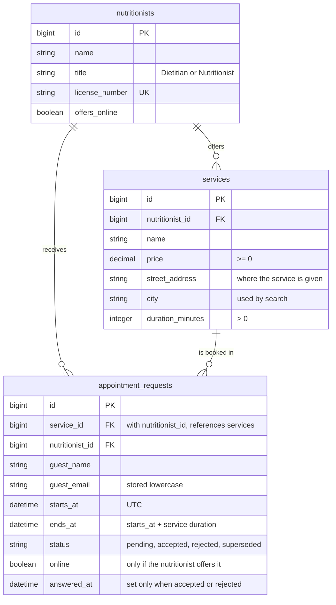

# NutriBook

Appointment requests for nutritionists. The project has a Next.js frontend in
`frontend/` and a Rails API in `backend/`.

## Start the backend and database

Install Docker with Docker Compose, then run from the project root.

```sh
docker compose up --build -d --wait
```

This starts two development containers, Rails at <http://localhost:3001> and
PostgreSQL on the Compose network. Rails prepares its databases before starting
the server. Check <http://localhost:3001/up> for the Rails health response.
Set `BACKEND_PORT` to choose another host port.

The database uses a named Docker volume that survives container restarts.
The `nutribook` database username and password in `compose.yaml` are local
development credentials. PostgreSQL is accessible to the backend as `db:5432`.
Use `docker compose exec db psql -U nutribook -d nutribook_development` for SQL.

```sh
docker compose logs -f backend
docker compose exec backend bin/rails console
docker compose exec backend bin/rails db:migrate
docker compose exec backend bin/rails test
docker compose exec backend bin/rubocop
docker compose down
```

Backend source changes reload through the bind mount. Rebuild the image after
changing the Gemfile or Gemfile.lock.

### Shortcuts

The root `package.json` wraps these commands as pnpm scripts, so you can run
them from the project root without typing `docker compose exec`. Extra
arguments pass through to the underlying command.

```sh
pnpm dev                  # start Docker services, then the frontend
pnpm stop                 # stop Docker services
pnpm rails <args>         # any Rails command, e.g. pnpm rails generate model Service
pnpm db:migrate
pnpm db:rollback
pnpm db:seed
pnpm db:psql
pnpm backend:test         # add a path to run one file
pnpm backend:lint
pnpm backend:ci
pnpm backend:console
pnpm backend:logs
pnpm frontend:lint
pnpm frontend:typecheck
pnpm frontend:build
pnpm test                 # backend tests
pnpm lint                 # backend and frontend lint
```

## Database



A guest is identified by email and has no table of their own; their name and
email live on each request. Every column is `NOT NULL` except `answered_at`, and
every table has `created_at` and `updated_at`.

The business rules that PostgreSQL can express are database constraints, so
they hold even if application code has a bug or two requests race:

| Rule | Constraint |
| --- | --- |
| A guest has at most one pending request | Partial unique index on `lower(guest_email)` where `status = 'pending'` |
| A nutritionist never has two accepted appointments that overlap | Exclusion constraint on `nutritionist_id` and `tsrange(starts_at, ends_at)` where `status = 'accepted'` (`btree_gist`). Ranges are half-open, so 10:00–11:00 and 11:00–12:00 do not overlap |
| A request's service belongs to the request's nutritionist | Composite foreign key `(nutritionist_id, service_id)` → `services (nutritionist_id, id)` |
| `answered_at` is set exactly when a nutritionist answered | Check that `answered_at IS NOT NULL` equals `status IN ('accepted', 'rejected')` |
| Valid values | Checks on `title`, `status`, `price >= 0`, `duration_minutes > 0`, and `ends_at > starts_at` |

A request copies its end time from the service's duration when it is created,
so editing a service later does not move existing appointments. `superseded`
marks a pending request replaced by the same guest's newer one, so it stays
distinct from a request the nutritionist rejected. Nutritionists and services
use `restrict_with_error`, so records that requests point to cannot be deleted.
The address belongs to the service, not the nutritionist: each service has the
street address and city where it is given. One nutritionist can work in several
cities, and at several addresses in the same city, so a nutritionist-level
address could not say where a listed service happens. The search card lists the
distinct addresses of the services it shows. (An earlier
version kept one address per nutritionist; it showed a Braga street on Porto
results.) A request reads the address from its service instead of copying it,
because services cannot be edited in the app. If editing is added, copy the
address and price onto the request when it is created.

`docker compose exec backend bin/rails db:seed` (or `pnpm db:seed`) creates 30
nutritionists across eight cities, with services at different prices and
durations. Braga, the default location, has enough for more than one results
page, three of its nutritionists also see patients in Porto, and one works from
two addresses in Braga. The first Braga nutritionist has four pending requests,
two of which overlap, to try the automatic rejection. Names come from Faker with a fixed
random seed, so every run produces the same data, and the file is idempotent.
Use `bin/rails db:seed:replant` to start over.

Indexes follow the queries: `services (city, nutritionist_id)` for search
by city, `services (nutritionist_id, id)` for the composite key and lookups by
nutritionist, and `appointment_requests (nutritionist_id, status, starts_at)`
for a nutritionist's request list.

## API

Interactive docs run at <http://localhost:3001/docs>. Swagger UI reads the
OpenAPI spec in `backend/public/openapi.yaml`, which is also served at
<http://localhost:3001/openapi.yaml>. The controller tests call
`assert_schema_conform(200)` from `committee-rails`. That call fails when a
request or response differs from the spec, so the docs stay in step with the
code. A new endpoint goes into the spec in the same change as its controller
test.

`GET /nutritionists` searches nutritionists. It takes three optional query
parameters.

| Parameter | Meaning |
| --- | --- |
| `q` | Matches part of a nutritionist's name or the name of one of their services at the location |
| `location` | The city to search |
| `page` | The results page, five nutritionists per page |

Matching ignores case and accents, so `joao` finds João and `guimaraes` finds
Guimarães. PostgreSQL's `unaccent` extension does this for `q`. The known
locations are the cities that have at least one service, plus `Lisbon` and
`Oporto` as aliases. A blank location searches Braga, and so does an unknown
one. The response says which case applied in `location.source`: `input`,
`default`, or `fallback`. A page past the end returns the last page, and a
missing or invalid page returns the first.

Results are ordered by name. Each nutritionist lists only the services they
offer at the searched location, ordered by street address and then by name.
Prices are decimal strings.

```sh
curl 'http://localhost:3001/nutritionists?q=first&location=braga'
```

```json
{
  "nutritionists": [
    {
      "id": 1,
      "name": "Mary Jane",
      "title": "Dietitian",
      "license_number": "2963N",
      "offers_online": true,
      "services": [
        {
          "id": 1,
          "name": "First appointment",
          "price": "25.0",
          "street_address": "Rua do Souto 45",
          "city": "Braga",
          "duration_minutes": 60
        }
      ]
    }
  ],
  "location": { "city": "Braga", "source": "input" },
  "pagination": { "page": 1, "per_page": 5, "total_count": 1, "total_pages": 1 }
}
```

`GET /locations` lists the cities that have at least one service, once each and
in alphabetical order, for the search form's location input. These are the
same cities `GET /nutritionists` accepts as known locations; both read
`Service.cities`. `default` is the city a blank or unknown location
searches.

```sh
curl 'http://localhost:3001/locations'
```

```json
{ "locations": ["Braga", "Porto"], "default": "Braga" }
```

`NutritionistSearch` in `backend/app/models/` owns location resolution,
matching, and paging. It runs a fixed number of queries whatever the page
size, because the page's services are preloaded in one query.

`POST /appointment_requests` books a pending request. The guest sends a name,
an email, a service, a day and a time, and whether the appointment is online.

```sh
curl -X POST 'http://localhost:3001/appointment_requests' \
  -H 'Content-Type: application/json' \
  -d '{"appointment_request": {"service_id": 1, "guest_name": "Joana Silva",
       "guest_email": "joana.silva@example.com", "date": "2026-12-07",
       "time": "10:00", "online": false}}'
```

It returns `201` with the request, or `422` with messages per field, written
for the guest so the frontend shows them as they are:

```json
{ "errors": { "starts_at": ["Pick one of the available times."] } }
```

All times are Portuguese wall-clock time. The API takes the day and the time
as they were picked, and `BookingSchedule` reads them in `Europe/Lisbon` and
stores UTC, so a 10:00 booking stays 10:00 across daylight saving changes.
`BookingSchedule` also owns the opening hours: Monday to Saturday, on the
hour, from 09:00 to 18:00 except 13:00. A new request must start on one of
those slots, in the future, and must not overlap an appointment the
nutritionist already accepted, because that request could never be accepted.
Online is only allowed when the nutritionist offers it. The frontend renders
the same slots in its time picker; the API is the one that enforces them.

`GET /nutritionists/:id/appointment_requests` returns the nutritionist and
every request still waiting for their answer, soonest first. Requests whose
time has passed stay in the list until the nutritionist answers them, so every
guest gets an answer. An unknown id returns `404 { "error": "Nutritionist not
found" }`; `ApplicationController` turns any missing record into that JSON
response.

```sh
curl 'http://localhost:3001/nutritionists/1/appointment_requests'
```

```json
{
  "nutritionist": { "id": 1, "name": "Mary Jane" },
  "appointment_requests": [
    {
      "id": 7,
      "guest_name": "Rita Gomes",
      "guest_email": "rita.gomes@example.com",
      "starts_at": "2026-12-01T10:00:00.000Z",
      "ends_at": "2026-12-01T11:00:00.000Z",
      "online": false,
      "service": { "id": 1, "name": "First appointment" }
    }
  ]
}
```

It runs two queries whatever the number of requests: the nutritionist, then
the pending requests with their services preloaded, served by the
`appointment_requests (nutritionist_id, status, starts_at)` index.

`AppointmentRequest.submit` creates the request in one transaction. It takes a
transaction-scoped advisory lock on the guest's email, marks the guest's
pending request `superseded`, and inserts the new one. The lock makes two
submissions from the same guest run one after the other, so the newer one
always wins instead of failing on the one-pending-per-guest index. Different
guests never wait for each other. A test holds one submission open, starts a
second, and checks that it waits and then supersedes the first.

## Frontend

Run the frontend separately, with the backend running.

```sh
cd frontend
cp .env.example .env.local   # API_URL=http://localhost:3001
pnpm install
pnpm dev
```

The frontend runs at <http://localhost:3000>. `API_URL` is required; the app
stops with a message pointing at `.env.example` if it is missing.

The search page reads `GET /nutritionists` and `GET /locations` from Server
Components. "Schedule appointment" sends the request to
`POST /appointment_requests` through the `requestAppointment` Server Action
in `frontend/src/app/actions.ts`. The nutritionist's pending requests page is
at <http://localhost:3000/nutritionists/123/requests>; it has no
authentication, as the challenge allows. The endpoints for listing and
answering requests, and the email notifications, are pending implementation.
Until then the requests page reads a mock list in
`frontend/src/lib/pending-requests.ts`; accepting or rejecting a request
removes it from an in-memory list that resets when the server restarts.

```sh
pnpm test                    # Vitest
pnpm lint
pnpm exec tsc --noEmit
```

### Frontend decisions

- **The backend owns every rule.** Matching, the Braga default and fallback,
  paging, and the list of known cities come from the API. The frontend renders
  what it gets and keeps no copy of those rules.
- **The booking form does not validate.** It posts through a Server Action
  with `useActionState`, and Rails answers with messages per field, already
  written for the guest. `toAppointmentErrors` puts each message under its
  field, and changing a field clears its message. The day and time travel as
  the guest picked them (`2026-12-07`, `10:00`), so no time zone conversion
  happens in the browser or in Node. The time picker shows the same slots as
  `BookingSchedule`; that list is the one rule kept in both places, because
  the picker has to render it, and the API still rejects anything else.
- **Responses are parsed at the boundary.** `frontend/src/lib/api/` is the only
  code that calls Rails. A small Zod schema per endpoint checks the payload,
  renames snake_case to camelCase, and turns decimal price strings into
  numbers; the app's types are inferred from those schemas. The backend
  request tests pin the same JSON shape.
- **No caching.** Search and locations are fetched fresh on every request.
  Results change only when the seeds run, nothing would invalidate a cache
  tag, and free-text queries rarely repeat a cache key.
- **Search runs on submit.** The form is a plain GET to `/` through
  `next/form`, so the search lives in the URL and works without JavaScript.
  Live search-as-you-type was tried and dropped: keeping the inputs in step
  with the URL across typing, back, and links took more state than the
  challenge justifies. A `key` built from the search remounts the inputs on
  every navigation, so they always show the URL's values.
- **Two kinds of failure.** When Rails is unreachable, times out after five
  seconds, or answers 5xx, the results area shows an inline "Search is
  unavailable" message and the search form keeps working, and the booking
  form says the request could not be sent and keeps what the guest typed. Anything else, such
  as a 4xx or a payload that fails parsing, is a bug and reaches
  `app/error.tsx`.

## Design

`frontend/DESIGN.md` is the design reference. The UI follows the challenge's
reference image, which is a Nutrium page, and takes its palette and shapes from
nutrium.com: the Nutrium green, slate text, coral and mint action buttons, pill
buttons, and flat white cards. Shades are darkened where the reference falls
below the 4.5:1 that body text needs: white on the Nutrium green is 2.65:1, so
the header band and green text use a darker green. Headings use Outfit in place
of Nutrium's commercial Geomanist.

Inter and Outfit load through `next/font/google`, so `pnpm build` needs
network access to download them.
