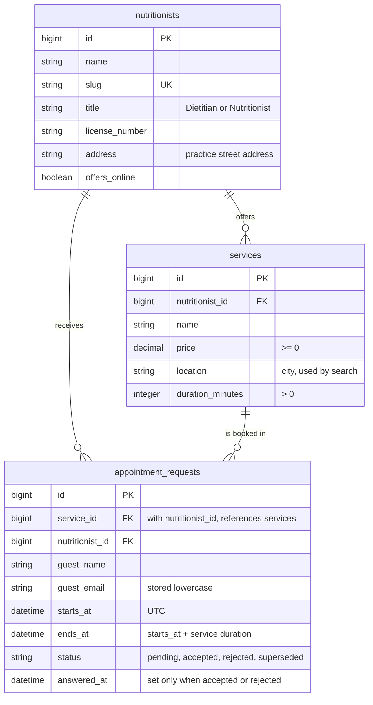

# NutriBook

Appointment requests for nutritionists. The project has a Next.js frontend in
`frontend/` and a Rails API in `backend/`.

## Start the backend and database

Install Docker with Docker Compose, then run from the project root.

```sh
docker compose up --build -d --wait
```

This starts two development containers, Rails at <http://localhost:3001> and
PostgreSQL on the Compose network. Rails prepares its databases before starting
the server. Check <http://localhost:3001/up> for the Rails health response.
Set `BACKEND_PORT` to choose another host port.

The database uses a named Docker volume that survives container restarts.
The `nutribook` database username and password in `compose.yaml` are local
development credentials. PostgreSQL is accessible to the backend as `db:5432`.
Use `docker compose exec db psql -U nutribook -d nutribook_development` for SQL.

```sh
docker compose logs -f backend
docker compose exec backend bin/rails console
docker compose exec backend bin/rails db:migrate
docker compose exec backend bin/rails test
docker compose exec backend bin/rubocop
docker compose down
```

Backend source changes reload through the bind mount. Rebuild the image after
changing the Gemfile or Gemfile.lock.

### Shortcuts

The root `package.json` wraps these commands as pnpm scripts, so you can run
them from the project root without typing `docker compose exec`. Extra
arguments pass through to the underlying command.

```sh
pnpm dev                  # start Docker services, then the frontend
pnpm stop                 # stop Docker services
pnpm rails <args>         # any Rails command, e.g. pnpm rails generate model Service
pnpm db:migrate
pnpm db:rollback
pnpm db:seed
pnpm db:psql
pnpm backend:test         # add a path to run one file
pnpm backend:lint
pnpm backend:ci
pnpm backend:console
pnpm backend:logs
pnpm frontend:lint
pnpm frontend:typecheck
pnpm frontend:build
pnpm test                 # backend tests
pnpm lint                 # backend and frontend lint
```

## Database



A guest is identified by email and has no table of their own; their name and
email live on each request. Every column is `NOT NULL` except `answered_at`, and
every table has `created_at` and `updated_at`.

The business rules that PostgreSQL can express are database constraints, so
they hold even if application code has a bug or two requests race:

| Rule | Constraint |
| --- | --- |
| A guest has at most one pending request | Partial unique index on `lower(guest_email)` where `status = 'pending'` |
| A nutritionist never has two accepted appointments that overlap | Exclusion constraint on `nutritionist_id` and `tsrange(starts_at, ends_at)` where `status = 'accepted'` (`btree_gist`). Ranges are half-open, so 10:00–11:00 and 11:00–12:00 do not overlap |
| A request's service belongs to the request's nutritionist | Composite foreign key `(nutritionist_id, service_id)` → `services (nutritionist_id, id)` |
| `answered_at` is set exactly when a nutritionist answered | Check that `answered_at IS NOT NULL` equals `status IN ('accepted', 'rejected')` |
| Valid values | Checks on `title`, `status`, `price >= 0`, `duration_minutes > 0`, and `ends_at > starts_at` |

A request copies its end time from the service's duration when it is created,
so editing a service later does not move existing appointments. `superseded`
marks a pending request replaced by the same guest's newer one, so it stays
distinct from a request the nutritionist rejected. Nutritionists and services
use `restrict_with_error`, so records that requests point to cannot be deleted.
The street address belongs to the nutritionist, while each service names the
city it is offered in, so one nutritionist can see patients in several cities.

`docker compose exec backend bin/rails db:seed` (or `pnpm db:seed`) creates 30
nutritionists across the eight cities the frontend offers, with services at
different prices and durations. Braga, the default location, has enough for
more than one results page, and three of its nutritionists also see patients in
Porto. The first Braga nutritionist has four pending requests, two of which
overlap, to try the automatic rejection. Names come from Faker with a fixed
random seed, so every run produces the same data, and the file is idempotent.
Use `bin/rails db:seed:replant` to start over.

Indexes follow the queries: `services (location, nutritionist_id)` for search
by city, `services (nutritionist_id, id)` for the composite key and lookups by
nutritionist, and `appointment_requests (nutritionist_id, status, starts_at)`
for a nutritionist's request list.

## API

`GET /nutritionists` searches nutritionists. It takes three optional query
parameters.

| Parameter | Meaning |
| --- | --- |
| `q` | Matches part of a nutritionist's name or the name of one of their services at the location |
| `location` | The city to search |
| `page` | The results page, five nutritionists per page |

Matching ignores case and accents, so `joao` finds João and `guimaraes` finds
Guimarães. PostgreSQL's `unaccent` extension does this for `q`. The known
locations are the cities that have at least one service, plus `Lisbon` and
`Oporto` as aliases. A blank location searches Braga, and so does an unknown
one. The response says which case applied in `location.source`: `input`,
`default`, or `fallback`. A page past the end returns the last page, and a
missing or invalid page returns the first.

Results are ordered by name. Each nutritionist lists only the services they
offer at the searched location. Prices are decimal strings.

```sh
curl 'http://localhost:3001/nutritionists?q=first&location=braga'
```

```json
{
  "nutritionists": [
    {
      "id": 1,
      "slug": "mary-jane",
      "name": "Mary Jane",
      "title": "Dietitian",
      "license_number": "2963N",
      "address": "Rua do Souto 45",
      "offers_online": true,
      "services": [
        {
          "id": 1,
          "name": "First appointment",
          "price": "25.0",
          "location": "Braga",
          "duration_minutes": 60
        }
      ]
    }
  ],
  "location": { "city": "Braga", "source": "input" },
  "pagination": { "page": 1, "per_page": 5, "total_count": 1, "total_pages": 1 }
}
```

`GET /locations` lists the cities that have at least one service, once each and
in alphabetical order, for the search form's location input. These are the
same cities `GET /nutritionists` accepts as known locations; both read
`Service.locations`. `default` is the city a blank or unknown location
searches.

```sh
curl 'http://localhost:3001/locations'
```

```json
{ "locations": ["Braga", "Porto"], "default": "Braga" }
```

`NutritionistSearch` in `backend/app/models/` owns location resolution,
matching, and paging. It runs a fixed number of queries whatever the page
size, because the page's services are preloaded in one query.

## Frontend

Run the frontend separately, with the backend running.

```sh
cd frontend
cp .env.example .env.local   # API_URL=http://localhost:3001
pnpm install
pnpm dev
```

The frontend runs at <http://localhost:3000>. `API_URL` is required; the app
stops with a message pointing at `.env.example` if it is missing.

The search page reads `GET /nutritionists` and `GET /locations` from Server
Components. The nutritionist's pending requests page is at
<http://localhost:3000/nutritionists/123/requests>; it has no authentication,
as the challenge allows. The request endpoints and email notifications are
pending implementation. Until then the requests page reads a mock list in
`frontend/src/lib/pending-requests.ts`; accepting or rejecting a request
removes it from an in-memory list that resets when the server restarts.

```sh
pnpm test                    # Vitest
pnpm lint
pnpm exec tsc --noEmit
```

### Frontend decisions

- **The backend owns every rule.** Matching, the Braga default and fallback,
  paging, and the list of known cities come from the API. The frontend renders
  what it gets and keeps no copy of those rules.
- **Responses are parsed at the boundary.** `frontend/src/lib/api/` is the only
  code that calls Rails. A small Zod schema per endpoint checks the payload,
  renames snake_case to camelCase, and turns decimal price strings into
  numbers; the app's types are inferred from those schemas. The backend
  request tests pin the same JSON shape.
- **No caching.** Search and locations are fetched fresh on every request.
  Results change only when the seeds run, nothing would invalidate a cache
  tag, and free-text queries rarely repeat a cache key.
- **Two kinds of failure.** When Rails is unreachable, times out after five
  seconds, or answers 5xx, the results area shows an inline "Search is
  unavailable" message and the search form keeps working. Anything else, such
  as a 4xx or a payload that fails parsing, is a bug and reaches
  `app/error.tsx`.

## Design

`frontend/DESIGN.md` is the design reference. The UI keeps the layout of the
challenge's reference image (search band, result card, numbered pagination) and
deliberately changes its colours and type: ink-black actions, flat white cards,
Cal Sans headings, and green as a single accent. The reference's white-on-green
and green-on-white text is about 2.65:1, below the 4.5:1 that body text needs.

Inter and Cal Sans load through `next/font/google`, so `pnpm build` needs
network access to download them.
