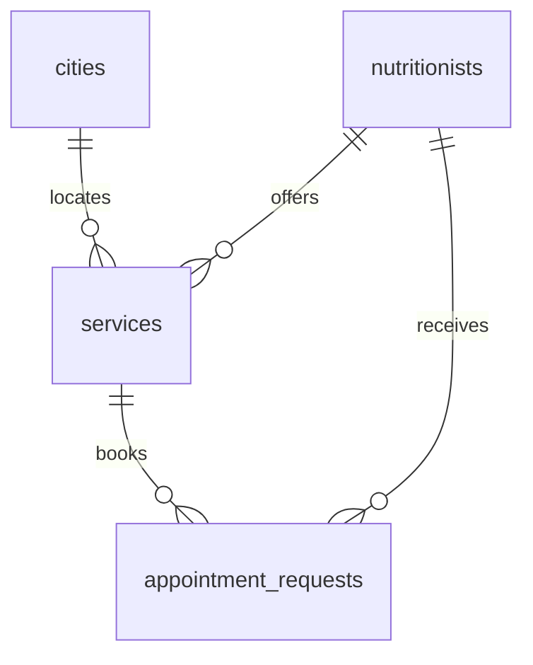

# NutriBook

NutriBook is a web application where guests find a nutritionist and request an appointment. The nutritionist accepts or rejects it, and the guest gets the answer by email.

## Demo

<p align="center">
  
</p>


## How to run it

Everything runs on Docker (backend and frontend). You only need Docker with Docker Compose.

```sh
git clone https://github.com/rgllm/NutriBook.git
cd NutriBook
docker compose up
```


The first run creates the database and automatically loads the demo data. There is no `.env` file to prepare or separate seed command to run.

| What                        | Where                        |
| --------------------------- | ---------------------------- |
| Application                 | <http://localhost:3000>      |
| Email inbox (Mailpit)       | <http://localhost:8025>      |
| API documentation (Swagger) | <http://localhost:3001/docs> |
| Rails API                   | <http://localhost:3001>      |

Mailpit catches the emails, so you can use an address like `guest@example.com`
and read the replies in the inbox. Nothing is sent to a real email address.

The frontend and backend run in development mode with the source mounted and have hot reload. Each start rebuilds the images from cache, so a dependency change is picked up on the next start.
To stop the demo, run `docker compose down`. The database stays in a Docker volume, so your requests are still there when you start it again.

With pnpm installed, `pnpm dev` and `pnpm stop` run the same two commands from the repository root.

## Demo and seed data

The seed data has 30 nutritionists across 8 cities, with different services, prices, and durations. Some work in more than one city or at more than one address. Braga has enough results to try pagination.

1. Search by nutritionist name or service, then change the city. A blank or unknown location falls back to Braga. Try `sprts nutrition` to see typo matching, or sort by **Distance** to order the selected city’s practices by distance from you.
2. Open **Schedule appointment**, choose a service, and enter a name, email, date, and time. This sends a request. The appointment is only confirmed when the nutritionist accepts it.
3. Make another request with the same email, even with a different nutritionist. It **replaces the previous pending request**.
4. Open a nutritionist requests page and accept or reject a request. Then check the email inbox.
5. Accept one of the two overlapping demo requests. The confirmation lists the other request that will be rejected. Both guests get an email.
6. Switch between English and Portuguese. The answer email uses the website language the guest booked in.

### Nutritionists Requests page to try

These links use example IDs from the local demo. The scenarios describe the initial seed data, before you answer or replace any requests.

| Scenario | Example page | What to try |
| --- | --- | --- |
| Pending and overlapping requests | [Requests page](http://localhost:3000/nutritionists/242/requests) | Four pending requests. Accept either Monday 10:00 request to see the overlap confirmation. The other is rejected automatically, and both guests get an email. |
| Requests without overlaps | [Same requests page](http://localhost:3000/nutritionists/242/requests) | Accept or reject the Monday 14:00 or Tuesday 09:00 request. Only that card leaves the list, and its guest gets an email. |
| Superseded request | [Same requests page](http://localhost:3000/nutritionists/242/requests) | Copy a pending guest's email and use it to make another request, with this nutritionist or another one. Refresh the original page: the old request is gone, and only the new one remains pending with the chosen nutritionist. |
| No pending requests | [Empty requests page](http://localhost:3000/nutritionists/243/requests) | Shows the empty state. |
| Unknown nutritionist | [Missing nutritionist](http://localhost:3000/nutritionists/999999/requests) | Shows "Page not found" for an ID that does not exist. |
| Invalid ID | [Invalid requests URL](http://localhost:3000/nutritionists/1abc/requests) | Shows "Page not found" for a malformed ID. |

### Reset the seed data

To restore the original requests, run the following. This deletes the current application data. The backend stays stopped during the reset because its email worker uses the same database.

```sh
docker compose stop backend
docker compose run --rm --no-deps backend bin/rails db:seed:replant
docker compose up -d --wait backend
```

## System Design

This project and repo has two apps. Rails owns the data and booking rules. Next.js renders the frontend and handles the forms through Server Actions, which call the Rails API.
| Part | Stack |
| --- | --- |
| Backend | Ruby 3.4, Rails 8.1 API, PostgreSQL 18 |
| Frontend | Next.js 16, React 19, TypeScript, Tailwind CSS v4, shadcn/ui with Base UI |
| Email | Active Job and Solid Queue, with Mailpit for the demo inbox |

The frontend container runs the Next.js dev server. Rails, PostgreSQL, and Mailpit run alongside it in Compose. The email worker runs inside Puma, so there is no separate worker service to start.

### Booking Rules



Some rules:

- Guests have no account.
- Each request stores their name and email.
- Nutritionists have a unique licence number.
- A service belongs to one nutritionist and has its own price, duration, street address, and city (keeping
addresses on services lets a nutritionist work at several practices).

A request can be `pending`, `accepted`, `rejected`, or `superseded`.

- A guest can have one pending request across all nutritionists. A valid new request replaces it. An invalid submission leaves the old request alone.
- Replacing a request marks it as `superseded` and sends no email. It is the guest changing their choice, not a nutritionist answering it.
- Accepting a request rejects every other pending request for that nutritionist that overlaps it. Each answered request gets an email job.
- Overlap uses the full service duration. An appointment ending at 11:00 leaves 11:00 available for the next one.
- Pending requests do not expire. They remain answerable after their requested time, with an overdue badge. New requests must be in the future.

I enforce these rules both with Rails transactions and database constraints. The database allows only one pending request per email, prevents double bookings for the same nutritionist, and checks that the selected service belongs to that nutritionist. There are also checks for valid states, prices, durations, and time ranges.

Submissions use an advisory lock per guest email and a shared lock on the nutritionist. Accepting or rejecting locks the nutritionist with `FOR NO KEY UPDATE`, then locks the request. These locks prevent race conditions, with database constraints as a final safeguard.

Before accepting, the UI shows which overlapping requests will be rejected. Rails rechecks them inside the transaction. If a new overlap has appeared, acceptance is blocked until the nutritionist reviews it.

### Dates, services, and online appointments

- I assumed a fixed schedule: Monday to Saturday, with appointment starts every 30 minutes from 09:00 to 18:00 and a lunch break from 13:00 to 14:00.

- Already booked times are disabled
in the calendar, and Rails checks availability again when the form is submitted.

- The request keeps the end time calculated at booking. Changing a service duration later would not move that appointment. Prices and addresses still come from the service.
- Online is an option when the nutritionist offers it. It uses the same service, price, and duration, and the email shows "Online" instead of an address.
- Services still need a physical address; online-only services are outside the scope.

### Search

- I kept search in PostgreSQL with `pg_trgm` and GIN indexes. It handles names, services, accents, and some typos without a separate search service.

- Every query word must match the nutritionist or the same service. Results rank by relevance unless the guest chooses distance.

- Distance sorting stays within the selected city and uses each nutritionist's nearest matching service.
- Demo addresses use real streets and coordinates, already included in the seeds.

### Frontend

- Pages fetch data in Server Components. Interactive parts, such as the booking modal and calendar, use Client Components.
- Search filters and pagination live in the URL, so results can be shared and browser navigation works as expected.
- API responses are validated with Zod.
- Server Actions submit bookings and answers, then refresh the affected page data.
- UI and answer emails support English and Portuguese. The selected language is saved in a cookie, and each request keeps the language used when booking. Service names and addresses stay as entered.

### Email

- Solid Queue shares the application database. Answering a request and queuing its emails happen in the same transaction, including automatic rejections.
- A rollback removes both the answer and its jobs.
- The delivery job retries temporary SMTP failures up to 10 attempts and records
when a message was sent. SMTP cannot guarantee exactly-once delivery: if it
accepts a message but the job fails before saving that marker, a retry can send
another copy. Permanent failures remain in Solid Queue for inspection and retry
through `SolidQueue::FailedExecution` in the Rails console. The same applies
when a job runs out of retries.

## Tests

- I test the booking rules against PostgreSQL, including constraints and concurrent submissions and answers.
- Frontend tests cover form behavior and API handling.
- Playwright runs the whole flow through the browser, database, email worker, and inbox.

| Tests                                      | Tools                                                                                                  |
| ------------------------------------------ | ------------------------------------------------------------------------------------------------------ |
| Models, requests, mailers, jobs, and seeds | Minitest                                                                                               |
| Frontend logic and components              | Vitest and React Testing Library                                                                       |
| API requests and responses                 | Shared [OpenAPI contract](backend/public/openapi.yaml), checked by backend tests and frontend fixtures |
| Full user flows (E2E)                      | Playwright in Chromium                                                                                 |

E2E covers search, distance sorting, booking, replacement, acceptance, rejection, overlap emails, and both languages.

To run the checks, install Node.js at the version in [.nvmrc](.nvmrc) and pnpm 12.18.0. With the demo stack running, run these from the repository root:

```sh
pnpm --dir frontend install --frozen-lockfile
pnpm --dir e2e install --frozen-lockfile
pnpm --dir e2e exec playwright install chromium
docker compose up -d --wait
pnpm check
pnpm e2e
```

Each Playwright run resets its own `nutribook-e2e` Compose stack and mailbox.
It uses ports 3100, 3101, and 8125 by default and leaves the demo data alone.
Tests run one at a time, with no retries. Failures keep screenshots and traces
in `e2e/test-results/`.

For a shorter run, use `pnpm test` for the Rails and frontend suites, or `pnpm lint` for the linters alone. `pnpm e2e:down` removes the end-to-end stack
and its data. To open the Playwright report:

```sh
pnpm --dir e2e exec playwright show-report
```
